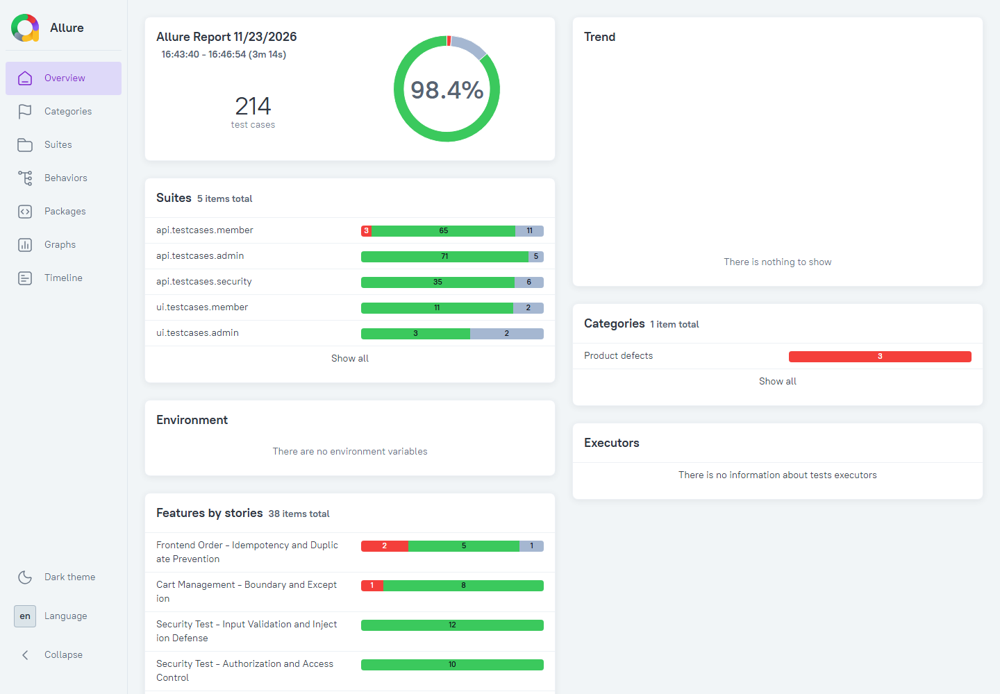
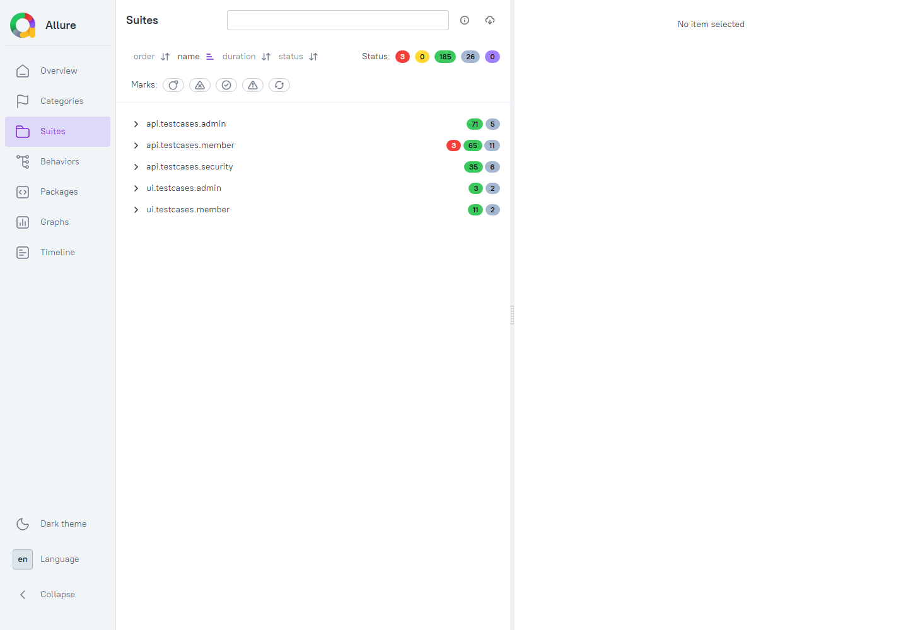
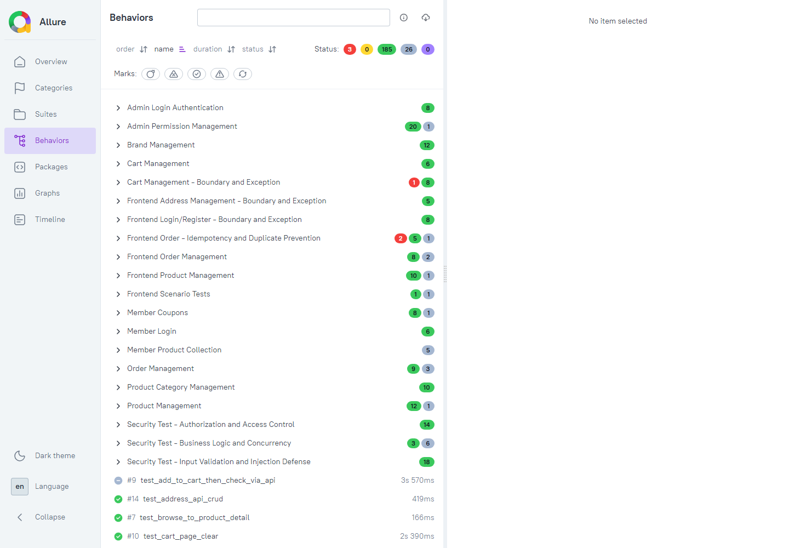
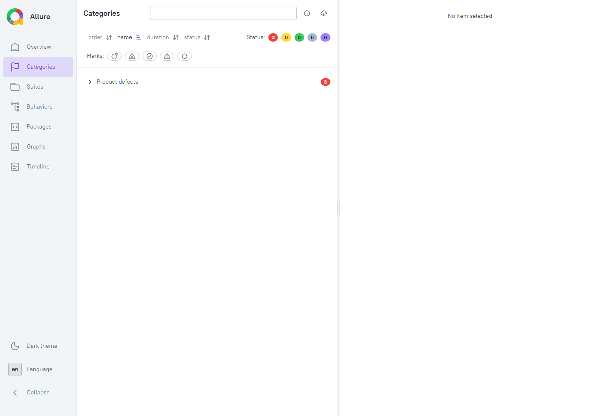

# Mall 商城自动化测试

针对开源电商系统 [macrozheng/mall](https://github.com/macrozheng/mall)（Spring Boot + Vue3 + uni-app H5 + MySQL + Redis）的自动化测试工程，包含 **接口自动化、UI 自动化、性能压测** 三部分，统一用 pytest + Allure 管理。


## 测试范围

| 类型 | 数量 | 位置 |
|---|---:|---|
| 功能测试用例（手工设计） | 100 | `docs/Mall功能测试用例.xlsx` |
| 接口自动化 | 197 | `api/testcases/` |
| UI 自动化 | 18 | `ui/testcases/` |
| 性能压测 | 场景化 | `performance/` |

接口用例覆盖后台管理、会员端、安全专项；UI 用例覆盖会员端购物主流程与后台登录。

## 主要功能

- **接口自动化**：按业务封装 API Object，支持多角色 Token 隔离、接口 + 数据库双层断言、参数化与边界/异常用例
- **UI 自动化**：Playwright + Page Object，覆盖登录、浏览、搜索、加购、下单、地址管理；关键操作后调用接口二次校验，避免"页面成功但数据未落库"
- **性能压测**：Locust 混合流量模型 + 阶梯负载，请求级指标与 MySQL / Redis 水位按毫秒对齐，输出可归因的对齐报告
- **测试报告**：全部用例接入 Allure，失败自动附加截图、trace、控制台日志

## 目录结构

```
.
├── api/            # 接口测试：objects（业务封装）/ testcases / fixtures
├── ui/             # UI 测试：pages（Page Object）/ testcases
├── performance/    # 性能压测：tasks / metrics / orchestration / analysis
├── common/         # 公共模块：client / assertions / config / db / utils
├── docs/           # 测试文档、用例 Excel、报告截图
├── conftest.py     # 全局 fixture 注册
├── pytest.ini
└── requirements.txt
```

## 环境要求

| 组件 | 版本                                                  |
|---|-----------------------------------------------------|
| Python | 3.13                                                |
| pytest | 9.0                                                 |
| Playwright | 1.65（Chromium）                                      |
| Locust | 2.46                                                |
| Allure | 2.42                                                |
| 被测环境 | mall 后端 API 8080 / 8085，前端 admin 5173 / member 5174 |

## 快速开始

```bash
# 1. 安装依赖
pip install -r requirements.txt
python -m playwright install chromium

# 2. 配置被测环境
cp common/config/config.example.yml common/config/config.yml
# 修改 config.yml 中的服务地址、账号、数据库连接
```

也支持环境变量覆盖（优先级更高）：接口地址 `MEMBER_URL` / `ADMIN_URL`，UI 地址 `MALL_MEMBER_URL` / `MALL_ADMIN_URL`，以及 `DB_HOST`、`REDIS_HOST` 等。

```bash
# 接口测试
python -m pytest api/testcases/ -v

# UI 测试
python -m pytest ui/testcases/ -v

# 全量 + Allure 报告
python -m pytest api/testcases/ ui/testcases/ --alluredir=reports/allure-results
allure generate reports/allure-results -o reports/allure-report --clean
allure open reports/allure-report -p 9999

# 性能压测：恒定负载
locust -f performance/locustfile.py --headless -u 10 -r 2 -t 2m --host http://127.0.0.1:8085

# 性能压测：5 档阶梯
locust -f performance/locustfile.py --shape performance.orchestration.shape.InstrumentStepShape --headless -u 1 -r 1 --host http://127.0.0.1:8085
```

> 压测前需把 `performance/data/users.csv`、`products.csv` 替换为被测环境真实数据。

## 执行结果

**185 通过 / 26 跳过 / 3 失败**。
3 条失败均为被测系统真实缺陷（购物车数量为 0 仍可入库、查询/取消不存在订单静默成功），详见 [测试报告](docs/mall-test-report.md)。

| 总览 | 按测试层分组 |
|---|---|
|  |  |

| 业务视图 | 失败分类 |
|---|---|
|  |  |

## 持续集成

仓库自带 [Jenkinsfile](Jenkinsfile)，流水线使用 `python:3.13-slim` 容器运行：

| 阶段 | 说明 |
|---|---|
| Prepare | 安装依赖与 Chromium |
| Apply Config | 从 Jenkins 文件凭据 `mall-test-config` 写入 `config.yml` |
| Health Check | 校验接口与前端地址可达 |
| API / UI Test | 按参数执行对应测试层，生成 Allure 与 pytest HTML 结果 |
| Performance Smoke | 可选，执行 1 分钟 Locust 冒烟 |

构建参数可覆盖被测地址、测试层、并发数与压测开关；构建结束后发布 Allure 报告，并归档 HTML 结果与压测 CSV。
需要 Jenkins 安装 Allure 与 HTML Publisher 插件。

## 已知问题

- 被测系统部分接口缺少参数与存在性校验，用例以失败或跳过如实记录，不做隐藏
- 商品搜索依赖独立 mall-search 服务，默认不纳入压测流量
- 中间件指标采集依赖目标机 `mysql` / `redis-cli`，缺失时自动跳过

## 文档

- [测试方案](docs/test-plan.md)
- [测试报告](docs/mall-test-report.md)
- [性能压测报告](docs/locust-performance-report.md)