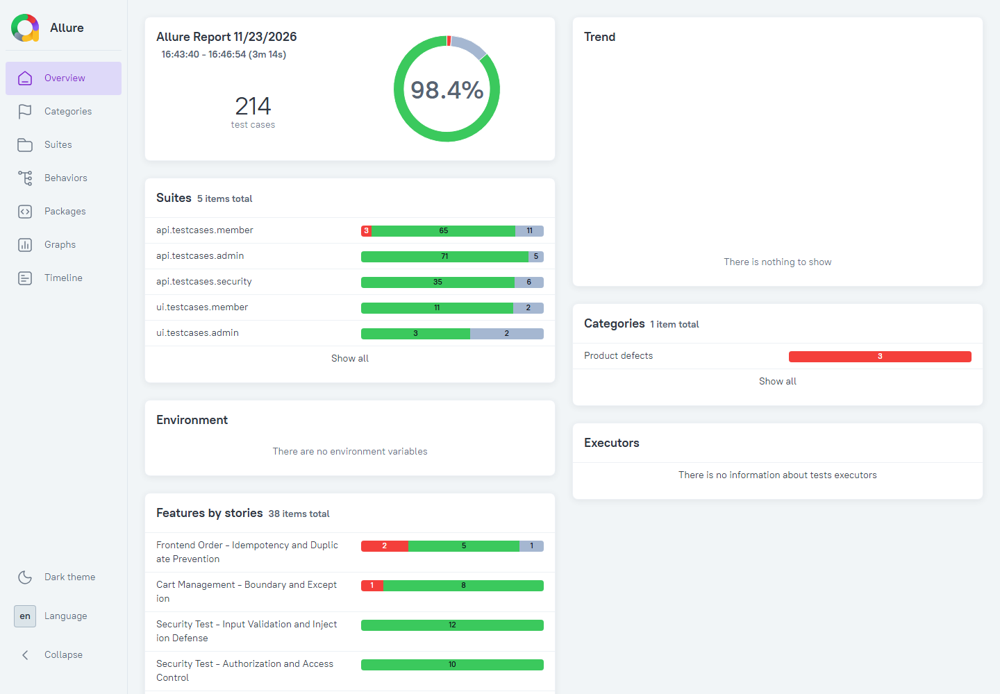
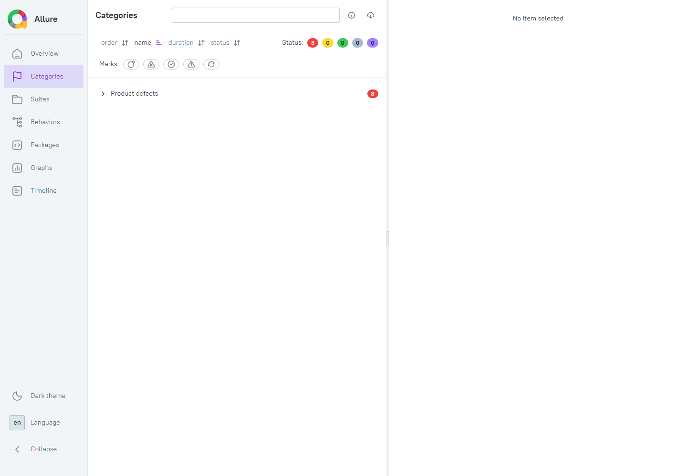
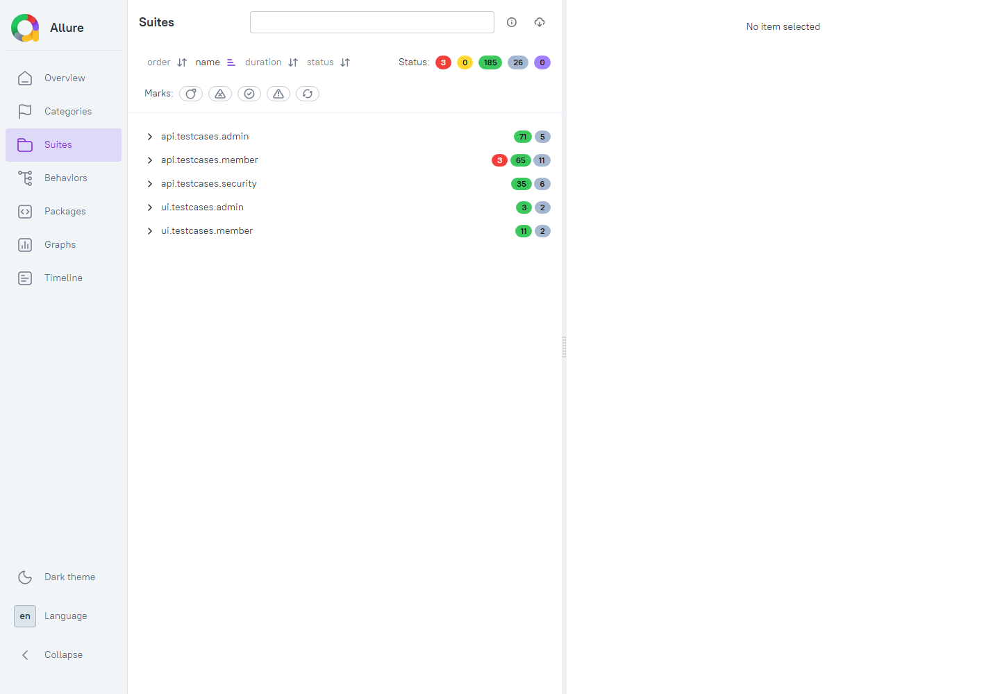
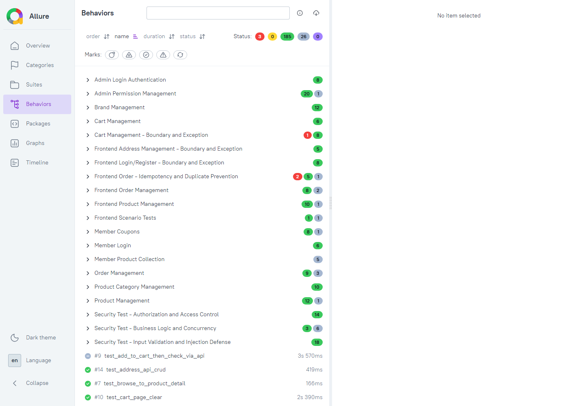
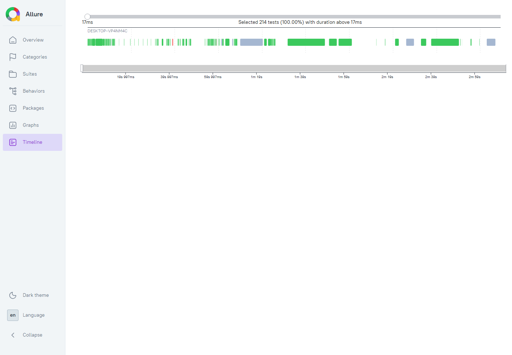

# 测试报告

## 1. 用例概览

| 类型 | 数量 | 说明 |
|---|---:|---|
| 功能测试用例 | 100 | 手工设计，覆盖 50 个功能模块 |
| 接口自动化 | 197 | 后台 76 / 会员 80 / 安全 41 |
| UI 自动化 | 18 | 会员 13 / 后台 5 |
| 自动化合计 | 215 | 全部接入 Allure |

## 2. 执行结果

| 结果 |  数量 |
|---|----:|
| 通过 | 186 |
| 跳过 |  26 |
| 失败 |   3 |

UI 层 18 条中 15 条通过、3 条跳过，无失败。

## 3. 发现的问题

3 条失败均为被测系统真实缺陷，可稳定复现：

| 接口 | 预期 | 实际 |
|---|---|---|
| `POST /cart/add`，quantity = 0 | 拒绝并提示数量必须大于 0 | 返回成功，数据库出现数量为 0 的购物车记录 |
| `GET /order/detail/{不存在的 id}` | 返回订单不存在 | 返回成功，订单明细为空列表 |
| `POST /order/cancelUserOrder?orderId={不存在的 id}` | 返回订单不存在 | 返回"操作成功" |

另有一个已知问题：`/coupon/listByProduct` 恒定返回 HTTP 500。

## 4. 跳过原因

| 原因 | 数量 |
|---|---:|
| 缺少特定测试账号或权限 | 9 |
| 本地无 MySQL，数据库相关 fixture 不满足 | 10 |
| 依赖接口返回异常或后端缺陷 | 2 |
| 后台商品页面对象尚未实现 | 2 |
| 其他前置条件不满足 | 3 |

## 5. 报告展示

| 总览 | 失败分类 |
|---|---|
|  |  |

| 按测试层分组 | 业务视图 |
|---|---|
|  |  |

执行时间线：

